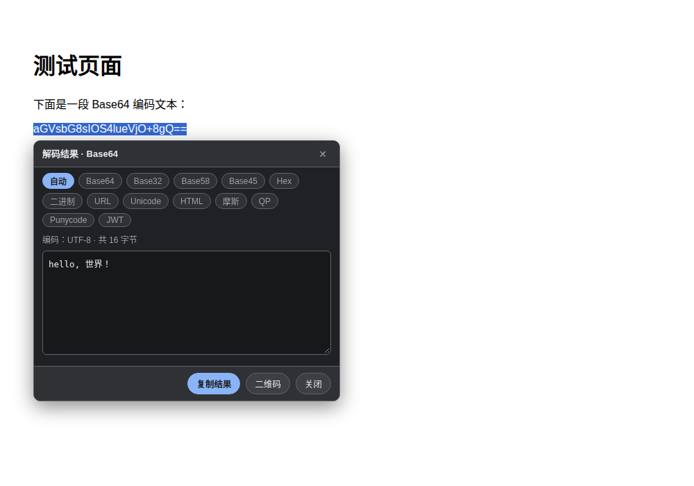
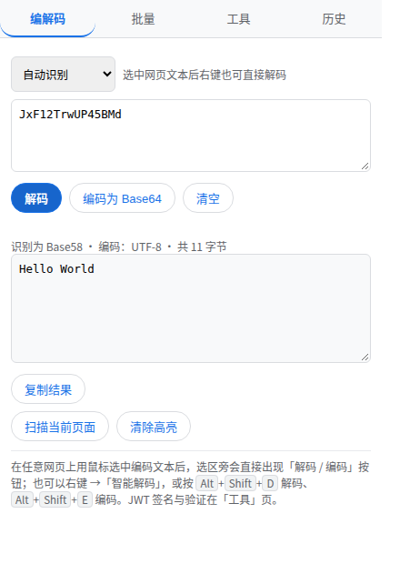
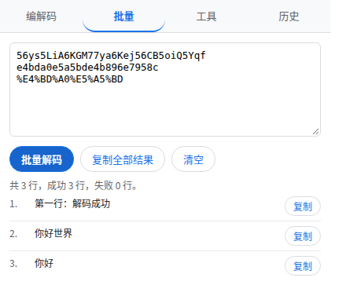
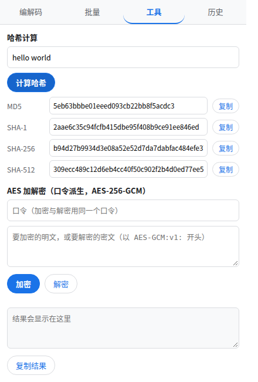
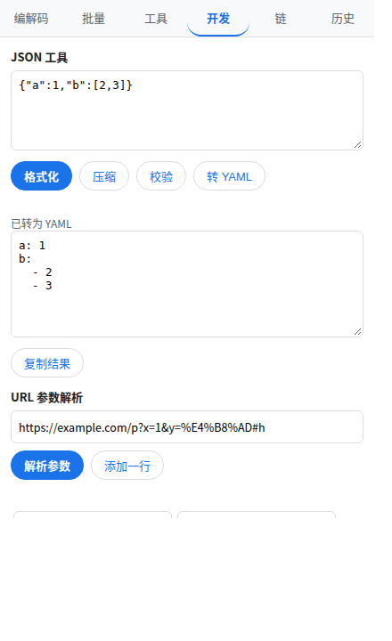
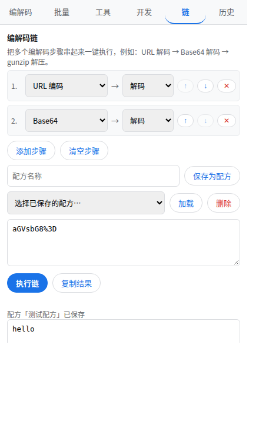
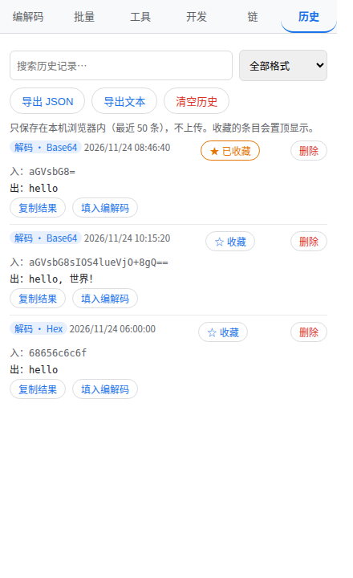

# 码上解 SnapDecode

选中网页上的编码文本，一键智能解码，结果直接显示在选中位置旁边。

支持 Base64 / Base32 / Base58 / Base62 / Base85 / Base91 / Base122 / Base32768 / Base45、Hex、二进制、八进制、URL 编码、Unicode 转义、HTML 实体、Quoted-Printable、Punycode、摩斯电码、ROT13 / 凯撒、gzip/deflate + Base64 与 JWT 解析，附带编解码链、批量解码、页面扫描、二维码生成与识别、历史记录（收藏/筛选/导出）与哈希 / HMAC / AES / TripleDES / ChaCha20 / SM4 / RSA / ECDSA / SM2 / JWT 工具箱，以及 JSON / URL 参数 / 正则 / 文本对比开发工具。纯本地运行，不收集、不上传任何数据。

## 截图

选中页面上的编码文本，旁边直接出现「解码 / 编码」按钮，点一下就出结果：

工具栏弹窗里也可以手动粘贴编解码、批量解码、算哈希与 AES 加解密：

| 编解码 | 批量解码 | 工具箱 |
| --- | --- | --- |
|  |  |  |

v4.0.0 新增开发工具、编解码链与历史收藏/导出：

| 开发工具 | 编解码链 | 历史记录 |
| --- | --- | --- |
|  |  |  |

## 功能

### 选中即解（核心）
- **悬浮按钮**：鼠标选中疑似编码的内容后，选区旁直接出现「解码 / 编码」按钮，点一下就解
- **右键菜单**：选中后右键 →「智能解码」或「编码为 Base64」
- **快捷键**：`Alt+Shift+D` 解码，`Alt+Shift+E` 编码（可在 `chrome://extensions/shortcuts` 里改）
- **就地弹窗**：结果显示在选中文字旁边的悬浮面板里，带一键复制；点面板外任意处或按 `Esc` 关闭

### 智能识别
自动判断选中内容是什么格式，无需事先分辨：
- **Base 系列**：Base64（标准 + URL 安全，自动补齐缺失的 `=`，忽略换行/空格，自动去掉 `data:...;base64,` 前缀和外层引号）、Base32（RFC 4648）、Base58（比特币字母表）、Base62、Base85（Ascii85，支持 `z` 缩写与 `<~ ~>` 包裹）、Base91、Base122、Base32768、Base45（RFC 9285）
- **Hex** 十六进制、**二进制**、**八进制**
- **URL 编码**（`%XX`）、**Quoted-Printable**（`=XX`）、**Punycode**（域名 `xn--` 互转，RFC 3492）
- **gzip/deflate + Base64**：压缩后再 Base64 编码，一键互转
- **Unicode 转义**（`\uXXXX`、`\xXX`）
- **HTML 实体**（`&amp;`、`&#x4f60;` 等命名与数字实体）
- **摩斯电码**（字母之间空格分隔，单词之间 `/` 分隔）
- **ROT13 / 凯撒密码**（凯撒位移可在弹窗里设置，默认 3）
- **JWT**：展开 Header / Payload，`exp` / `iat` / `nbf` 自动转成可读时间（带“还有 X 天 / 已过期”）；签名与验证（HS256）在「工具」页
- 面板里可手动切换格式重新解；解出非 UTF-8 文本时自动尝试 GBK / GB18030
- 自动检测说明：Base122 / Base32768 误判风险高，只在弹窗里手动选择，不进自动检测

### 解码增强
- **多层解码**：结果本身还是编码文本时可「再次解码」，逐层解开，附「上一步」返回
- **JSON 格式化**：解出 JSON 自动美化排版，可切换看原文
- **图片预览**：解出图片（PNG / JPEG / GIF / WebP / BMP）直接显示，并可下载
- **自动解压**：解出 gzip / zlib 压缩数据自动解开
- **智能提取**：选中内容混了其他文字时，自动抠出里面的编码片段；多处可解时列出清单任选

### 编解码链（弹窗「链」页签）
- 把多个编解码步骤串起来一键执行，例如：URL 解码 → Base64 解码 → gunzip 解压
- 步骤可添加、删除、上移/下移，每步可选格式与编码/解码方向
- 常用链可保存为配方（存在本机），随时加载、删除

### 二维码
- 弹窗「编解码」页点「生成二维码」，把当前结果（或输入）生成二维码图片，可下载
- 点「识别页面二维码」，扫描当前页面所有图片里的二维码并在页面上列出结果（跨域图片因浏览器安全限制无法读取，会注明跳过数量）
- 选中文本解码后，结果面板里也有「二维码」按钮

### 批量与扫描
- **批量解码**：弹窗「批量」页，每行一条，逐行解码并标注成功/失败，可一键复制全部结果
- **扫描页面**：弹窗里点「扫描当前页面」，一键高亮本页所有疑似编码内容，点击任意一处直接解码

### 历史记录
- 最近 50 条解码/编码记录保存在本机（`chrome.storage.local`，不上传、不漫游）
- 弹窗「历史」页可搜索、按格式筛选、复制结果、填回编解码页、逐条删除或一键清空
- 可收藏/置顶常用条目（收藏的条目排在前面），可导出为 JSON 或文本文件

### 工具箱（弹窗「工具」页）
- **哈希计算**：MD5、SHA-1、SHA-256、SHA-384、SHA-512、SHA3-256、RIPEMD-160、SM3、CRC32
- **文件哈希**：把文件拖进工具页直接算以上全部哈希（文件只在本地读取，不上传）
- **HMAC**：HMAC-SHA256、HMAC-SHA512
- **对称加解密**：AES-256-GCM / CBC / CTR、TripleDES-ECB / CBC、ChaCha20-Poly1305、国密 SM4-ECB / CBC（口令派生密钥，PBKDF2 10 万次；密文自带模式前缀，解密时自动识别模式；口令错误会明确报错），RC4、XOR（输出十六进制密文）
- **非对称加密**：RSA-OAEP 2048 密钥对生成与加解密、ECDSA P-256 签名验证、国密 SM2 加密与签名（密钥只显示在本页，不保存、不上传）
- **JWT 签名与验证**：HS256 生成 Token、验证签名有效性
- **生成器**：UUID v4、随机密码（可调长度与字符集）
- **时间戳转换**：Unix 时间戳（秒/毫秒自动识别）与日期时间互转

### 开发工具（弹窗「开发」页签）
- **JSON 工具**：格式化、压缩、校验、转 YAML
- **URL 参数解析**：把 URL 的查询参数拆成可编辑的表格，改完一键拼回完整 URL
- **正则测试**：写正则表达式、粘贴文本，匹配处高亮显示并计数
- **文本对比**：两段文本按行对比，删除行红色、新增行绿色

### 其他
- **剪贴板自动解码**：复制编码文本后打开弹窗，自动填入并解码（需要 `clipboardRead` 权限，见下方权限说明）
- **暗色模式**：弹窗界面跟随系统深色/浅色设置

## 安装（开发者模式加载）

本扩展尚未上架 Chrome 应用商店，请按以下步骤手动安装：

1. 下载本仓库（`Code` → `Download ZIP` 后解压，或 `git clone https://github.com/751317151/snapdecode.git`），之后不要移动或删除这个文件夹
2. 打开 Chrome，地址栏输入 `chrome://extensions` 回车
3. 右上角打开「开发者模式」
4. 点左上角「加载已解压的扩展程序」，选择解压后的文件夹
5. 装好后**刷新一下已打开的网页**（新开的页面不用），即可使用

更新到新版本时：重新下载/拉取最新代码覆盖原文件夹，然后在 `chrome://extensions` 里点插件卡片上的刷新按钮（↻）即可。

## 发布到 Chrome 应用商店

如需把本扩展发布到 Chrome 应用商店（需自行准备 Google 账号）：

1. 打开 [Chrome Web Store Developer Dashboard](https://chrome.google.com/webstore/devconsole)，注册开发者账号（一次性付费 5 美元）
2. 把本仓库内容打包成 zip 上传，填写商店介绍、截图等信息
3. 提交审核（通常几天内完成），通过后任何人都能从商店安装

## 文件说明

| 文件 | 说明 |
| --- | --- |
| `manifest.json` | 插件清单（Manifest V3） |
| `background.js` | 后台 Service Worker：右键菜单、快捷键 |
| `codec.js` | 共享的编解码逻辑：Base64/32/58/62/85/91/122/32768/45、Hex、二进制、八进制、URL、Quoted-Printable、Punycode、gzip/deflate+Base64、Unicode、HTML 实体、摩斯、ROT13/凯撒、JWT、格式识别、片段提取、图片/gzip 检测 |
| `cryptools.js` | 哈希与加密：MD5、SHA（含 SHA-384）、SHA3-256、RIPEMD-160、SM3、CRC32、HMAC、AES-GCM/CBC/CTR、TripleDES、ChaCha20-Poly1305、SM4、RC4、XOR、RSA、ECDSA、SM2、JWT HS256 签名验证、UUID/密码/时间戳 |
| `lib/qrcode.js` | 二维码生成库（qrcode-generator，MIT 许可，本地内置） |
| `lib/jsqr.js` | 二维码识别库（jsQR，Apache-2.0 许可，本地内置） |
| `lib/LICENSE-qrcode.txt` / `lib/LICENSE-jsQR.txt` | 两个二维码库的许可证全文 |
| `store.js` | 历史记录与编解码链配方的本地存取 |
| `content.js` | 内容脚本：读取选区、渲染悬浮结果面板、悬浮按钮、页面扫描（Shadow DOM） |
| `popup.html` / `popup.js` | 工具栏弹窗：编解码 / 批量 / 工具 / 历史 四个页签 |
| `icons/` | 插件图标（16 / 48 / 128） |
| `screenshots/` | README 用的示例截图 |

## 权限说明

- `contextMenus`：添加右键菜单
- `activeTab` + `scripting`：仅在页面缺少内容脚本时（如安装前就已打开的页面）临时注入一次；扫描页面功能也用它与当前标签页通信
- `storage`：历史记录与编解码链配方只存在本机，不上传
- `clipboardRead`：打开弹窗时读取一次剪贴板，如果里面是疑似编码的文本就自动填入并解码；剪贴板内容只在本地使用，不上传；拒绝授权时该功能静默跳过，不影响其他功能
- 内容脚本只在收到解码/编码指令时读取当前选区，不收集、不上传任何数据

## License

MIT
